# Animation Sequence と ActionRegistry

## 目次

- [データと実行処理](#データと実行処理)
- [再生の流れ](#再生の流れ)
- [Action の追加](#action-の追加)
- [既存 Action の例](#既存-action-の例)
- [保存と編集](#保存と編集)

## データと実行処理

`SequenceData` は名前、長さ、ActionReference の配列などを持ちます。各 `ActionReference` はカテゴリ／Action 名、実行時刻、任意の Blackboard 書き込み、生成 Object や画面遷移の待機条件などを保持します。Action 関数そのものは Sequence JSON に保存せず、文字列名で Registry から解決します。

`ActionRegistry` はカテゴリと Action 名で `std::function<void()>` を登録し、文字列名検索用の ID 索引を併せて持ちます。Scene 共通 Registry と GameObject のローカル Registry があり、ActionSequence の実行は Owner の `ExecuteAction` に流れます。

## 再生の流れ

```mermaid
flowchart LR
    Editor[Action Sequence Editor] --> Data[SequenceData]
    Data --> JSON[GameObject JSON]
    JSON --> Deserialize[ActionSequence::Deserialize]
    Deserialize --> Register[RegisterSequence]
    Register --> Local[Owner LocalRegistry]
    Local --> Start[StartSequence]
    Start --> Pending[時刻順 PendingAction]
    Pending --> Blackboard[Blackboard 書き込み]
    Blackboard --> Execute[Owner::ExecuteAction]
    Execute --> Registry[Local / Global Registry]
    Registry --> Callback[Action 関数]
```

再生開始時に予約 Action は時刻で安定ソートされ、`Update` で時間到達と待機条件を判定します。実行直前に指定 Blackboard 値を書き、Action を解決します。Sequence 完了時には設定されていれば完了 Action を実行します。

## Action の追加

既存の Action 実装に対しては、対象 Component の `IActionProvider::RegisterActions`（または全体登録処理）へ名前と関数を登録し、Sequence Editor からカテゴリ／名前を選ぶ方法があります。新しい Action 機能の内容によっては Component の実装追加も必要です。Registry と ActionSequence を変更せずに追加できるかは、既存の登録パターンに適合するかによります。

1. 実行主体となる Component または共通登録箇所で callback を実装する。
2. `RegisterAction(category, name, callback)` で登録する。
3. `ActionSequence` の Owner 上で Sequence に Action を追加する。
4. 保存後、Scene の JSON 読み込み時に ActionSequence がデータを復元し、再登録する。

## 既存 Action の例

`Controller.RumbleJustDodge` は `RegisterAllActions` でカテゴリ `Controller`、名前 `Controller.RumbleJustDodge` の関数として登録されます。関数は `ControllerInput::PlayRumble` を呼びます。Sequence 側では文字列名を保持し、実行時に Owner の Action 解決経路から該当 callback を呼びます。具体的な登録コードは [ActionRegistry.cpp](../Code/Engine/GamePlay/Serialize/ActionRegistry.cpp)、解決・呼び出し経路は [GameObject.cpp](../Code/Engine/GamePlay/Core/Object/GameObject.cpp) と [ActionSequence.cpp](../Code/Engine/GamePlay/EventSystem/ActionSequence.cpp) を参照してください。

## 保存と編集

ActionSequence は `Serialize` / `Deserialize` で Sequence 名、長さ、Action 名、カテゴリ、時間、Blackboard 値等を JSON に保存・復元します。Editor は `ActionSequenceEditorWindow` と Component の GUI を通じて編集します。アニメーション状態名を使った再生時刻指定もデータ項目としてありますが、対応する再生解釈の詳細は Controller 側の連携実装を参照してください。

### 関連コード

- [ActionSequence.h](../Code/Engine/GamePlay/EventSystem/ActionSequence.h)
- [ActionSequence.cpp](../Code/Engine/GamePlay/EventSystem/ActionSequence.cpp)
- [ActionRegistry.h](../Code/Engine/GamePlay/Serialize/ActionRegistry.h)
- [ActionRegistry.cpp](../Code/Engine/GamePlay/Serialize/ActionRegistry.cpp)
- [IActionProvider.h](../Code/Engine/GamePlay/EventSystem/IActionProvider.h)
- [ActionSequenceEditorWindow.cpp](../Code/Editor/Window/ActionSequenceEditorWindow.cpp)
- [AnimationControllerComponent.cpp](../Code/Engine/Graphics/Resource/Animation/AnimationControllerComponent.cpp)

関連する優先コードは [CodeHighlights](CodeHighlights.md) を参照してください。
