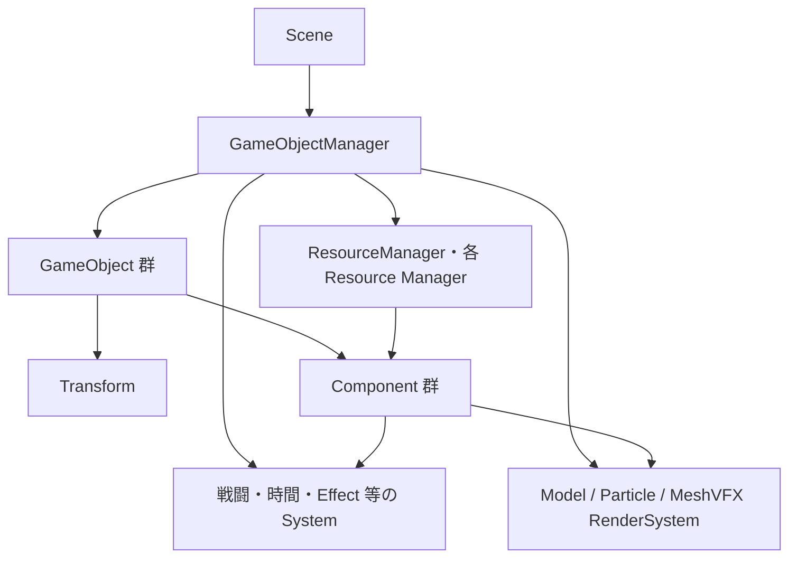
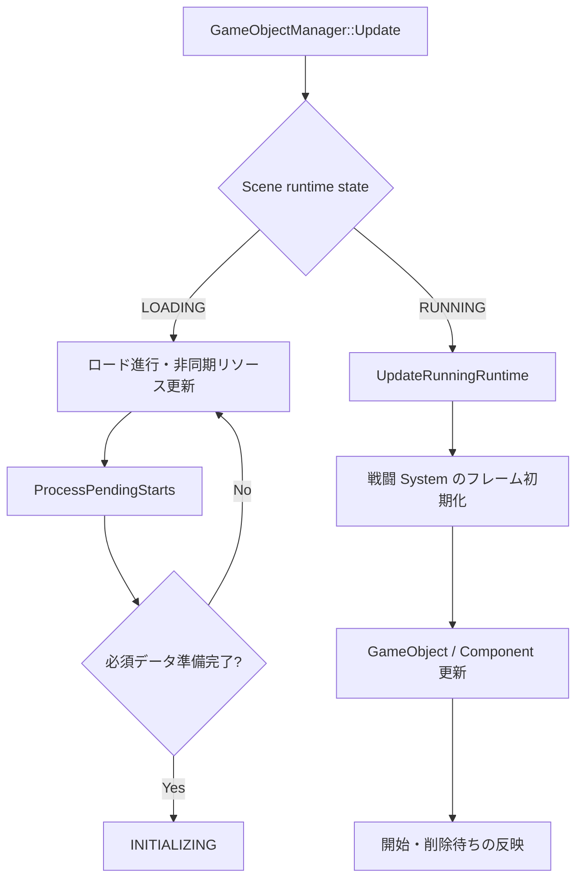

# BigShine の構成

## 目次

- [構成の概要](#構成の概要)
- [主要な責務](#主要な責務)
- [Scene 更新の概略](#scene-更新の概略)
- [設計上確認できる特徴](#設計上確認できる特徴)

## 構成の概要

ランタイムの中心は `GameObjectManager` です。Manager がシーン内の `GameObject` 群、ゲームプレイ用 System、描画 System、ResourceManager を所有し、各 GameObject が Transform と Component 群を保持します。Component は所有 GameObject を参照し、各 System や他 Component と連携します。

図は `GameObjectManager.h` の所有メンバーと `GameObject` の保持データから整理した関係です。すべての依存や呼び出しを網羅した図ではありません。

## 主要な責務

| 要素 | コードで確認できる責務 |
| --- | --- |
| `GameObject` | Transform、通常 Component、Collider Component、名前、ローカル Action を保持し、Component の生成・取得・更新・シリアライズを行う |
| `GameObjectManager` | GameObject の生成、シーン実行状態、開始待ち・削除待ち、ゲームプレイ System と描画 System の管理 |
| `Component` | GameObject に付与する個別機能。`Start`、`Update`、描画提出、JSON 保存などの共通口を持つ |
| `ActionRegistry` | カテゴリ／名前で登録された関数を保持し、文字列名から実行する |
| RenderSystem | 描画要求を集め、描画パス単位で GPU に発行する |

## Scene 更新の概略

`GameObjectManager::Update` はロード状態に応じてロード更新、初期化、通常実行へ分岐します。ロード中は非同期モデルロードや Effect の事前準備、開始可能な Object の処理を進め、必須リソースの準備を待ちます。通常実行ではフレーム単位の戦闘 System の準備後、Object と各 System を更新します。Object の追加・削除は待機リストを使い、走査中の配列変更を避けます。

細かな更新順は Scene 状態、Editor Play Mode、ロード表示などで分岐します。完全なフレーム順は [GameObjectManager.cpp](../Code/Engine/GamePlay/Core/Object/GameObjectManager.cpp) を参照してください。

## 設計上確認できる特徴

- 通常 Component と Collider Component は別の配列で保持されます。Collider は Physics 登録と更新順を考慮した扱いです。
- Component 構成変更は通知され、監視対象の再発見を毎フレーム行わないための仕組みがあります。
- Object の破棄予約時に `PrepareForDestroy` が Component の `OnDestroy`、実行抑制、Collider の物理 Actor 解放を行います。Manager の削除反映自体は予約後に行います。
- Scene のロード状態は `LOADING`、`INITIALIZING`、`RUNNING`、`FAILED` として管理されています。

### 関連コード

- [GameObject.h](../Code/Engine/GamePlay/Core/Object/GameObject.h)
- [GameObject.cpp](../Code/Engine/GamePlay/Core/Object/GameObject.cpp)
- [GameObjectManager.h](../Code/Engine/GamePlay/Core/Object/GameObjectManager.h)
- [ComponentBase.h](../Code/Engine/GamePlay/Core/Component/ComponentBase.h)

詳細は [GameObject / Component](GameObject_Component.md) を参照してください。
