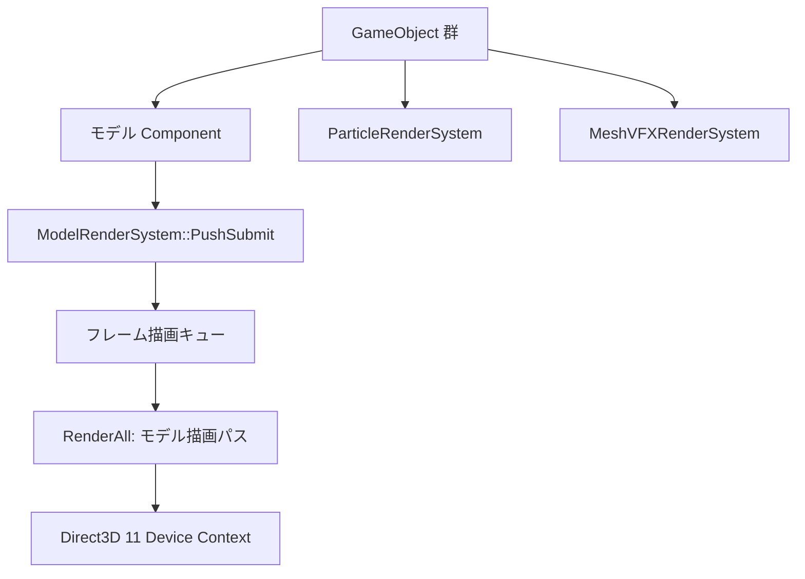

# Direct3D 11 描画システム

## 目次

- [描画要求から描画まで](#描画要求から描画まで)
- [モデル・マテリアル・スキニング](#モデルマテリアルスキニング)
- [シェーダーと表現](#シェーダーと表現)
- [関連コード](#関連コード)

## 描画要求から描画まで

`GameObjectManager` が Scene の描画処理を進め、モデル Component の描画要求を `ModelRenderSystem` に提出します。`ModelRenderSystem` はフレームの要求を集め、通常モデル、透過、デカール、アウトライン、カスケードシャドウ等の描画を担当します。Manager は Particle、MeshVFX、Sprite などの描画 System も管理し、モデル以外の描画経路も持ちます。

描画パスの正確な順序や条件は `ModelRenderSystem::RenderAll` と Manager の描画処理を参照してください。

## モデル・マテリアル・スキニング

モデル描画は glTF モデル Component と Resource を使用します。`ModelRenderSystem` には静的／スキンモデル、マテリアル、Texture、Shader のバインドや描画統計を記録する構造があります。スケルトン定数バッファには最大 256 個のボーン行列を保持する定義があり、スキンモデル用の頂点シェーダーも用意されています。

## シェーダーと表現

Shader ディレクトリには PBR 系（`PBRVS.hlsl` / `PBRPS.hlsl`）、Toon 系（`ToonVS.hlsl` / `ToonPS.hlsl`）、Toon PBR 系、スキンモデル用 Shader、Particle や MeshVFX 用 Shader が存在します。ファイルの存在だけから全機能の使用箇所や描画品質を断定しないため、ここでは Shader 群と描画 System の実装上の対応を確認できる範囲で紹介しています。

`GraphicsDeviceManager` が D3D11 のデバイス関連を担い、描画 System がリソースと描画要求を処理します。詳細な GPU リソース所有関係は Resource／Shader の各実装を合わせて確認してください。

### 関連コード

- [GraphicsDeviceManager.h](../Code/Engine/Graphics/Core/GraphicsDeviceManager.h)
- [ModelRenderSystem.h](../Code/Engine/Graphics/RenderSystem/ModelRenderSystem.h)
- [ModelRenderSystem.cpp](../Code/Engine/Graphics/RenderSystem/ModelRenderSystem.cpp)
- [GltfModel.h](../Code/Engine/Graphics/Resource/GltfModel.h)
- [ToonPBRSkinnedVS.hlsl](../Shader/ToonPBRSkinnedVS.hlsl)
- [ToonPBRPS.hlsl](../Shader/ToonPBRPS.hlsl)
- [PBRPS.hlsl](../Shader/PBRPS.hlsl)

関連するコード選定は [CodeHighlights](CodeHighlights.md) を参照してください。
